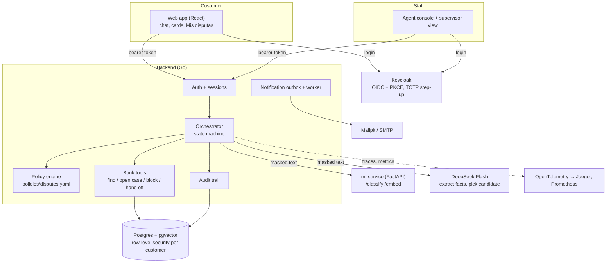

# Architecture

**AI proposes, code decides.** Language models read the customer's text and draft wording. What happens next
(open a case, block a card, hand off to a human) is decided by a versioned policy file and executed by Go code that
verifies every step. The assistant never moves money, never refunds and never shows another customer's data.

## Components

| Component | Tech | Responsibility |
|---|---|---|
| `frontend/` | React, Vite, MUI | Customer chat, cards and recent movements, "Mis disputas"; agent queue, handoff detail (claim, reveal identity, close); supervisor view (policy, metrics) |
| `backend/` | Go, chi, pgx | API, sessions, orchestrator, policy engine, simulated bank tools, audit, notification outbox |
| `ml/service/` | Python, FastAPI, sentence-transformers, scikit-learn | Dispute-type classifier (contract C2) and multilingual embeddings |
| `ml/` | MLflow | Corpus generation, training and comparison (`ml/train.py`), retrieval index (`ml/rag/`) |
| `etl/` | DuckDB, Polars, Pandera | Raw → silver with contracts, quarantine and lineage; Postgres loader |
| `eval/` | Python | Held-out cases anchored on real rows; system vs baseline harness |
| `infra/` | Keycloak, Postgres 16 + pgvector, OTel Collector, Jaeger, Prometheus, Mailpit | Identity, storage with RLS, observability, test mailbox |

## One customer turn: Understand → Decide → Act → Verify → Escalate

1. **Guard.** Personal data in the text is masked (`[NAME]`, `[EMAIL]`, `[NUMBER]`) before it reaches any model;
   instruction-override or forbidden-action patterns are refused (`SEC-INJ-01`).
2. **Understand.** The classifier (ml-service, model M3 = TF-IDF + multilingual-e5 logistic regressions) labels the
   dispute type (taxonomy C6) and abstains below a frozen confidence threshold. In parallel, DeepSeek Flash
   extracts amount, date and merchant (prompt `deepseek-prompts-v3`, masked input only; the same call says whether the message must be refused: another person's data, rewriting the assistant's rules, money without a process -> `SEC-INJ-01`). If the classifier
   abstains, the assistant asks what happened (`CLARIFY-TYPE`).
3. **Decide.** The customer's own card transactions are searched (row-level security pins the customer). Zero
   matches → ask for facts; several → let the customer pick; one → the policy engine evaluates it: not a final
   debit (reversed, declined, pending) → explain it; outside the window → human; over the USD threshold → human
   (with a card block proposal for unrecognized charges); otherwise open a case.
4. **Act.** Every action needs the customer's explicit confirmation; blocking a card also needs TOTP step-up
   (acr ≥ 2), enforced in the service layer.
5. **Verify.** After acting, the tool result is read back from the database and only verified facts reach the reply
   and the notification email.
6. **Escalate.** Handoffs (contract C5) carry verified facts, actions, evidence, open questions and suggested
   agents, never the raw transcript; the customer's identity is revealed only to the agent who claims it, and every
   reveal is audited. The claiming agent closes it with an outcome and a note, which the customer sees in
   "Mis disputas".

Replies are rendered from reviewed templates (`LLM_COMPOSE=template`); the AI rewrite mode exists but stays off
(ADR 0004: it dropped the decisive sentence in 3 of 11 replies).

## Contracts

| Id | Contract | Where |
|---|---|---|
| C1 | Chat API (`/api/chat`, `/api/chat/confirm`) and turn outcome `resolve / clarify / abstain / escalate / confirm` | `backend/internal/contract`, `openapi.yaml` |
| C2 | `/classify` and `/embed` | `ml/service/app.py`, `backend/internal/mlclient` |
| C3 | Dispute policy | `policies/disputes.yaml`, `backend/internal/policy` |
| C4 | Evaluation case JSONL | `eval/cases/`, `eval/RUBRIC.md` |
| C5 | Handoff payload | `backend/internal/contract`, `docs/api/contracts.md` |
| C6 | Dispute taxonomy | policy + classifier |

The OpenAPI spec is served at `/api/docs` and a test fails if any route is undocumented.

## Security

- **Identity.** Keycloak OIDC with PKCE; tokens carry an opaque `customer_ref`, never the bank's customer id.
  Card blocking requires TOTP (acr 2).
- **Data isolation.** Every customer query runs in a transaction pinned with `SET LOCAL app.customer_id`
  (resolved inside Postgres from `customer_ref`), and every customer table has `FORCE ROW LEVEL SECURITY`. Staff
  queries run with a staff role; handoffs and audit are visible to the owner or to staff.
- **Personal data.** Names and emails are stored encrypted (AES-GCM, `PII_KEY`); text sent to models is masked.
- **Prompt injection.** Pattern guard before any model, plus the model's refusal screen for other wordings; and models cannot trigger tools: only the orchestrator acts,
  after policy checks and customer confirmation.
- **Audit.** Every step (understand, extract, find, policy, propose, confirm, act, verify, handoff, identity
  reveal, close) is written to `audit_events` with the policy rule and trace id.

## Observability

OpenTelemetry traces per turn (Jaeger), Prometheus metrics (`chat_turns_total`, `chat_turn_duration_seconds`,
`llm_calls_total`, `ml_classify_seconds`, tool calls), structured JSON logs without customer text or identity.

## Data

Organizer synthetic dataset (Mexico, Colombia, Argentina; June 2023 – June 2026) → silver layer → Postgres.
The dataset has no dispute text, so the classifier is trained on a team-generated ES/PT corpus (`docs/ml_labels.md`),
and evaluation cases anchor an invented sentence on a real customer's real transaction (`eval/RUBRIC.md`).

## Decisions

[`docs/adr/`](adr/): single supervised agent (0001), FX normalization to USD at the transaction date (0002),
pseudonymized customer identity (0003), DeepSeek as LLM provider (0004), email notifications through an outbox
(0005).
