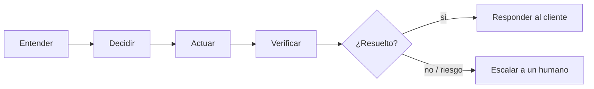

# El reto en simple

**Factored AI & Data Hackathon 2026.** Nos piden construir un sistema de atención al cliente para un banco de
Latinoamérica que sea **"AI-first", no un chatbot**. La diferencia:

| Un chatbot | Lo que pide el reto |
|---|---|
| Responde lo que "cree" | Responde solo con **datos verificados** y **políticas** del banco |
| Hace lo que el texto le pide | **Sabe cuándo NO actuar** y cuándo pasar a un humano |
| Dice "listo" | **Comprueba** que la acción ocurrió antes de decir "listo" |

El ciclo que tiene que seguir cada conversación:

## Qué elegimos

**Intake de disputas de tarjeta:** el cliente dice *"no reconozco un cobro"* y el sistema identifica la
transacción, clasifica el tipo de disputa, aplica las reglas y abre el caso, bloquea la tarjeta o lo pasa a un
especialista. **Nunca mueve dinero ni devuelve plata.** Plan B, si los datos no lo respaldan: soporte de tarjetas.

## Lo obligatorio

- Tres casos de demo: **normal** (se resuelve solo), **ambiguo o no soportado** (pregunta o se abstiene) y
  **requiere humano** (escala con un resumen útil).
- Demo en **español y portugués**.
- **Métricas** contra un *baseline* en casos que el sistema nunca vio (held-out). Ver [[Cómo nos evalúan]].
- Pruebas de fallo: datos faltantes, sesión expirada, acceso no autorizado, *prompt injection*, falla de
  herramientas, ambigüedad de idioma.

## Qué entregamos (lunes 5 de octubre)

Repo público `factored-hackathon-2026-nicebank`, link desplegado (lo gestiona la empresa), 4–6 slides y un video
pitch. Ver [[Calendario y gates]].

Siguiente: [[Visión general]].
