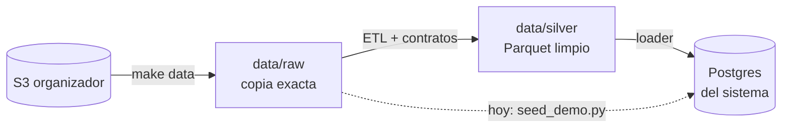

# Datos del proyecto

**Fuente:** dataset **sintético** del organizador (nada es real). 13 tablas, México, Colombia y Argentina,
17 jun 2023 → 17 jun 2026. Está en un bucket de S3 de solo lectura y ya lo tenemos completo en `data/raw/`
(7.671 archivos CSV, 5 GB). Hay copia comprimida en Descargas del líder.

## Las tablas que usamos

| Tabla | Qué tiene | Uso |
|---|---|---|
| `customers` | Clientes (país, segmento, acento) | Identidad del demo, cortes de equidad |
| `products` | Cuentas y **tarjetas** | Qué tarjetas tiene cada cliente, bloqueo |
| `transactions` | Movimientos | Buscar el cargo disputado |
| `complaints` | Reclamos (PQR) | Entender el problema, casos de prueba, baseline humano |
| `call_center_interactions` | Contactos al call center | Motivos de contacto, FCR, escalamiento |
| `call_transcripts` | Transcripciones | Entrenar el clasificador |
| `service_agents` | Agentes (idiomas, especialidad) | Sugerir a quién pasar el caso (hay 129 que hablan portugués) |
| `daily_exchange_rates` | Tasas de cambio diarias | Convertir montos a USD |

## Cómo fluyen los datos

Hoy Postgres se llena con `seed_demo.py` (20 clientes). El ETL completo es tarea de [[Persona 2 - Datos]]:
[[ETL y calidad de datos]].

## Hallazgos que hay que explicar

| Hallazgo | Por qué importa |
|---|---|
| Las tablas de hechos traen **84–88%** de las filas anunciadas | ¿Faltan llegadas tardías? Re-sincronizar y documentar |
| `digital_events` trae **156%**, `daily_exchange_rates` **439%** (12 pares de moneda por día) | Entender antes de convertir a USD |
| Una sola cabecera por tabla en todas sus particiones | La "evolución de esquema" hay que buscarla en el contenido |
| México: todas las transacciones en **USD**; aparece "Mexico" y "México" | Normalizar en el ETL |
| `complaints` **no tiene** `transaction_id` | Ligar reclamo ↔ transacción por producto + monto + fecha |
| ~29 transacciones por cliente en 3 años | Datos dispersos; el demo usa 3 transacciones marcadas `team_generated` |

> [!warning] Fuga de información
> `is_fraud`, `was_resolved`, `was_escalated`, y `resolution`/`status`/`compensation_granted` de los reclamos
> son **etiquetas para evaluar**, nunca entradas del sistema o del modelo.
