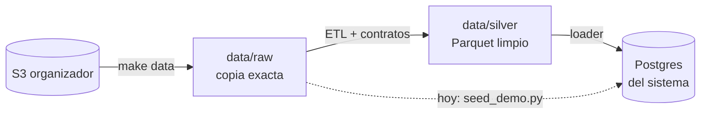

# Datos del proyecto

**Fuente:** dataset **sintético** del organizador (nada es real). 13 tablas, México, Colombia y Argentina,
17 jun 2023 → 17 jun 2026. Está en un bucket de S3 de solo lectura y ya lo tenemos completo en `data/raw/`
(7.671 archivos CSV, 5 GB). Hay copia comprimida en Descargas del líder.

## Las tablas que usamos

| Tabla | Qué tiene | Uso |
|---|---|---|
| `customers` | Clientes (país, segmento, acento) | Identidad del demo, cortes de equidad |
| `products` | Cuentas y **tarjetas** | Qué tarjetas tiene cada cliente, bloqueo |
| `transactions` | Movimientos | Buscar el cargo disputado |
| `complaints` | Reclamos (PQR) | Entender el problema, casos de prueba, baseline humano |
| `call_center_interactions` | Contactos al call center | Motivos de contacto, FCR, escalamiento |
| `call_transcripts` | Transcripciones | Entrenar el clasificador |
| `service_agents` | Agentes (idiomas, especialidad) | Sugerir a quién pasar el caso (hay 129 que hablan portugués) |
| `daily_exchange_rates` | Tasas de cambio diarias | Convertir montos a USD |

## Cómo fluyen los datos

Hoy Postgres se llena con `seed_demo.py` (20 clientes). El ETL completo es tarea de [[Persona 2 - Datos]]:
[[ETL y calidad de datos]].

## Hallazgos que hay que explicar

| Hallazgo | Por qué importa |
|---|---|
| Las tablas de hechos traen **84–88%** de las filas anunciadas | ✅ Explicado: el faltante está **repartido parejo** en los 3 años (no son datos recientes por llegar) y no hay duplicados que lo expliquen. Las cifras publicadas parecen metas nominales |
| `digital_events` trae **156%**, `daily_exchange_rates` **439%** | ✅ Explicado: tasas = 12 pares × 1.097 días = 13.164 filas exactas; `digital_events` simplemente es más grande (sin duplicados) |
| Una sola cabecera por tabla en todas sus particiones | ✅ Evolución en el contenido: en `campaign_sends`, `was_opened`, `subject` y los campos de apertura cambian mucho su % de vacíos según el mes |
| México: todas las transacciones en **USD**; aparece "Mexico" y "México" | Normalizar en el ETL, **pero** en `transaction_country` "Mexico" (sin tilde) marca compras internacionales, junto a USA, Spain y Brazil |
| `complaints` **no tiene** `transaction_id` | Ligar reclamo ↔ transacción por **cliente** + monto + fecha: `affected_product_id` nunca es del cliente que reclama |
| ~29 transacciones por cliente en 3 años | Datos dispersos; el demo usa 3 transacciones marcadas `team_generated` |

### Lo que encontró el perfilado

Informe completo: `docs/data_quality_report.md`. Lo que más le importa al equipo:

| Hallazgo | Por qué importa | A quién |
|---|---|---|
| **Cero duplicados** y **cero llegadas tardías** en 23,5 M de filas (el organizador anunció ~2% y llegadas tarde) | El ETL igual deduplica y procesa incremental: pueden llegar en otra entrega | P2 |
| **Corte de día** a las 06:00 (transacciones, eventos, campañas) u 08:00 (reclamos, llamadas): lo de madrugada queda con la fecha del día anterior | La fecha real sale del timestamp del evento, nunca de `process_date` | P2, P4 |
| Las encuestas quedan fechadas con el día de la llamada, no con el día en que se respondieron | Para analizar encuestas en el tiempo se usa `survey_date` | P2 |
| **Ningún cargo duplicado real** (mismo producto, comercio y monto en ≤ 2 días) | El tipo `duplicate_charge` necesita casos `team_generated` para el demo y la evaluación | P4 |
| `amount_usd` = conversión exacta × ruido de ±2%, y vacío en el 57% (todas las de USD) | El ETL lo recalcula con la tasa del día (ADR 0002) | P2 |
| Teléfonos de México con prefijo +54; ~48–50% de coordenadas en (0, 0) | No sirven para inferir país ni ubicación | P2, P3 |
| `customers.registration_branch_id` apunta a sucursales que no existen (100%) | No se trata como llave foránea en el ETL | P2 |
| `complaints.description` es texto de plantilla ("Queja relacionada con…") | El texto real de los clientes está en `call_transcripts` | P3 |

> [!warning] Fuga de información
> `is_fraud`, `was_resolved`, `was_escalated`, y `resolution`/`status`/`compensation_granted` de los reclamos
> son **etiquetas para evaluar**, nunca entradas del sistema o del modelo.
