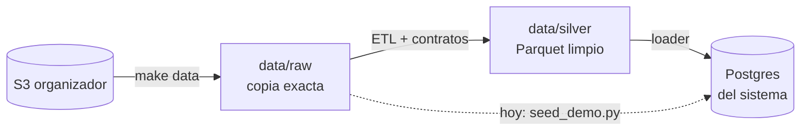

# Datos del proyecto

**Fuente:** dataset **sintético** del organizador (nada es real). 13 tablas, México, Colombia y Argentina,
17 jun 2023 → 17 jun 2026. Está en un bucket de S3 de solo lectura y ya lo tenemos completo en `data/raw/`
(7.671 archivos CSV, 5 GB). Hay copia comprimida en Descargas del líder.

**Diagrama entidad-relación** (silver y base operativa, se dibuja solo en Obsidian): [[Modelo ER]].

## Las tablas que usamos

| Tabla | Qué tiene | Uso |
|---|---|---|
| `customers` | Clientes (país, segmento, acento) | Identidad del demo, cortes de equidad |
| `products` | Cuentas y **tarjetas** | Qué tarjetas tiene cada cliente, bloqueo |
| `transactions` | Movimientos | Buscar el cargo disputado |
| `complaints` | Reclamos (PQR) | Entender el problema, casos de prueba, baseline humano |
| `call_center_interactions` | Contactos al call center | Motivos de contacto, FCR, escalamiento |
| `call_transcripts` | Transcripciones | Entrenar el clasificador |
| `service_agents` | Agentes (idiomas, especialidad) | Sugerir a quién pasar el caso (hay 129 que hablan portugués) |
| `daily_exchange_rates` | Tasas de cambio diarias | Convertir montos a USD |

## Cómo fluyen los datos

Desde el 29 sep, Postgres se llena con `etl/load_postgres.py` (`make seed`): **todo el dataset silver**
(150.000 clientes, 4,4 M transacciones), con los valores operativos en español y los mismos 20 usuarios de
demo. La flecha punteada de `seed_demo.py` ya no aplica; queda como biblioteca de utilidades. Detalle:
[[ETL y calidad de datos]].

## Hallazgos que hay que explicar

| Hallazgo | Por qué importa |
|---|---|
| Las tablas de hechos traen **84–88%** de las filas anunciadas | ✅ Explicado: el faltante está **repartido parejo** en los 3 años (no son datos recientes por llegar) y no hay duplicados que lo expliquen. Las cifras publicadas parecen metas nominales |
| `digital_events` trae **156%**, `daily_exchange_rates` **439%** | ✅ Explicado: tasas = 12 pares × 1.097 días = 13.164 filas exactas; `digital_events` simplemente es más grande (sin duplicados) |
| Una sola cabecera por tabla en todas sus particiones | ✅ Evolución en el contenido: en `campaign_sends`, `was_opened`, `subject` y los campos de apertura cambian mucho su % de vacíos según el mes |
| México: todas las transacciones en **USD**; aparece "Mexico" y "México" | Normalizar en el ETL, **pero** en `transaction_country` "Mexico" (sin tilde) marca compras internacionales, junto a USA, Spain y Brazil |
| `complaints` **no tiene** `transaction_id` | Ligar reclamo ↔ transacción por **cliente** + monto + fecha: `affected_product_id` nunca es del cliente que reclama |
| ~29 transacciones por cliente en 3 años | Datos dispersos; el demo usa 3 transacciones marcadas `team_generated` |

### Lo que encontró el perfilado

Informe completo: `docs/data_quality_report.md`. Lo que más le importa al equipo:

| Hallazgo | Por qué importa | A quién |
|---|---|---|
| **Cero duplicados** y **cero llegadas tardías** en 23,5 M de filas (el organizador anunció ~2% y llegadas tarde) | El ETL igual deduplica y procesa incremental: pueden llegar en otra entrega | P2 |
| **Corte de día** a las 06:00 (transacciones, eventos, campañas) u 08:00 (reclamos, llamadas): lo de madrugada queda con la fecha del día anterior | La fecha real sale del timestamp del evento, nunca de `process_date` | P2, P4 |
| Las encuestas quedan fechadas con el día de la llamada, no con el día en que se respondieron | Para analizar encuestas en el tiempo se usa `survey_date` | P2 |
| **Ningún cargo duplicado real** (mismo producto, comercio y monto en ≤ 2 días) | El tipo `duplicate_charge` necesita casos `team_generated` para el demo y la evaluación | P4 |
| `amount_usd` = conversión exacta × ruido de ±2%, y vacío en el 57% (todas las de USD) | El ETL lo recalcula con la tasa del día (ADR 0002) | P2 |
| Teléfonos de México con prefijo +54; ~48–50% de coordenadas en (0, 0) | No sirven para inferir país ni ubicación | P2, P3 |
| `customers.registration_branch_id` apunta a sucursales que no existen (100%) | No se trata como llave foránea en el ETL | P2 |
| `complaints.description` es texto de plantilla ("Queja relacionada con…") | Tampoco hay texto real en `call_transcripts` (ver el EDA abajo): las frases de disputa son `team_generated` | P3 |

### Lo que dice el EDA del Gate 1

Informe completo: `docs/eda_findings.md` (`make eda`). **Decisión: se confirma el flujo de disputas**, con dos
condiciones que imponen los datos.

| Pregunta | Respuesta | Qué implica |
|---|---|---|
| ¿Hay volumen? | ✅ El **40%** de los reclamos son disputas por cargos: "Cargo no reconocido" 20,2% + "Cobro indebido" 20,2% (27.133 en 3 años, ~700–800 al mes, estable). Mismo 40% en cada país, segmento y canal | El problema es grande y parejo |
| ¿Duele? | ✅ ~15 días para resolver, 20% incumple el SLA, 75% sigue abierto, ~38 h hasta la primera respuesta. Las llamadas de "Queja" se resuelven al primer contacto solo el 44% (vs 92% las transaccionales) y tienen el CSAT más bajo (2,4 de 5) | El argumento del pitch: tiempo y SLA. Ojo: en estos datos sintéticos las disputas no duelen *más* que otras categorías |
| ¿Podemos ligar el reclamo a su transacción? | ❌ Con el cliente real y con un cliente al azar se encuentra candidata en el **mismo 0,1%**: `claimed_amount` es un número al azar entre 50 y 5.000 en cualquier moneda (hasta MXN, que no existe en transacciones) | La transacción se busca con lo que dice el cliente en el chat (monto, fecha, comercio), como ya hace el backend |
| ¿Hay texto real de disputas? | ❌ Las 171.321 transcripciones salen de **2 plantillas** de consulta de saldo (42 textos de cliente distintos), todo en español; 0 mencionan un cargo, fraude, cajero o robo. No hay nada en portugués | P3 entrena y P4 evalúa con frases `team_generated` (ES y PT); las transcripciones solo sirven como ejemplos fuera de alcance |
| ¿Contactos por tipo de disputa? | ❌ `contact_reason` solo tiene 6 valores genéricos; "Queja" y "Transaccional" mezclan todo | Los reclamos son la única fuente que nombra disputas |

Taxonomía (C6) decidida el 28 sep, en `analysis/mappings/contact_reason_to_flow.csv`: `Transactions` ("Cargo no
reconocido") → `unrecognized_charge`, `Fees` ("Cobro indebido") → **`wrong_amount`**, el resto → `out_of_scope`. Se
eligió `wrong_amount` porque ya tiene reglas en la política; `other_in_scope` no tiene ninguna, así que el backend
solo preguntaría "¿qué pasó?" y terminaría pasando el caso a un humano.

### Validación de duplicados (29 sep)

Pregunta: ¿hay registros repetidos que no se ven porque un campo está mal escrito (acentos, mayúsculas,
espacios)? Respuesta: **no**, pero hay valores que se repiten entre personas distintas.

| Prueba | Resultado |
|---|---|
| Contenido completo normalizado (sin acentos, mayúsculas ni espacios de más), excluyendo el ID y `process_date`, en las 12 tablas con ID propio | 0 duplicados |
| Llaves de negocio: documento, nombre + fecha de nacimiento, número de producto, transacción (tarjeta + momento + monto), reclamo (cliente + fecha), llamada, encuesta, envío, evento | 0 duplicados reales |
| Nombres casi iguales (≤ 2 letras de diferencia) con la misma fecha de nacimiento y ciudad | 0 parejas |
| 19 parejas de clientes con mismo apellido, fecha de nacimiento y ciudad | Personas distintas: nombres de pila sin parecido (similitud ≤ 0,65), documentos que difieren en 5–9 caracteres, a veces otro tipo de documento y otro sexo. **Pendiente la decisión final de P2** |

Valores que **se repiten entre registros distintos** (no se fusionan; el ETL los marca):

| Qué | Cuántos | Por qué pasa |
|---|---|---|
| Correo de cliente compartido | 24.203 correos, 79.930 clientes (hasta 31 por correo) | El generador arma el correo con inicial + apellido (`aacosta@gmail.com`). **Importa para las notificaciones** |
| Celular de cliente compartido | 8 parejas | Coincidencia |
| Número de producto repetido | 6 parejas (cuentas y préstamos, no tarjetas) | Distinto cliente, moneda y fecha |
| Código de empleado / correo de agente repetido | 13 / 12 parejas | Personas distintas |
| Agentes homónimos (César González Sánchez) | 1 pareja | Todo lo demás distinto; queda **para revisión** |
| Nombre de sucursal repetido | 52 nombres, 227 sucursales | Distinta dirección, código y fecha de apertura |

El detalle registro por registro está en `analysis/out/duplicate_review/` (fuera de Git). El ETL repite estas
pruebas en cada carga como **guardia**: si una entrega futura trae un duplicado real, va a cuarentena.

> [!warning] Fuga de información
> `is_fraud`, `was_resolved`, `was_escalated`, y `resolution`/`status`/`compensation_granted` de los reclamos
> son **etiquetas para evaluar**, nunca entradas del sistema o del modelo.
