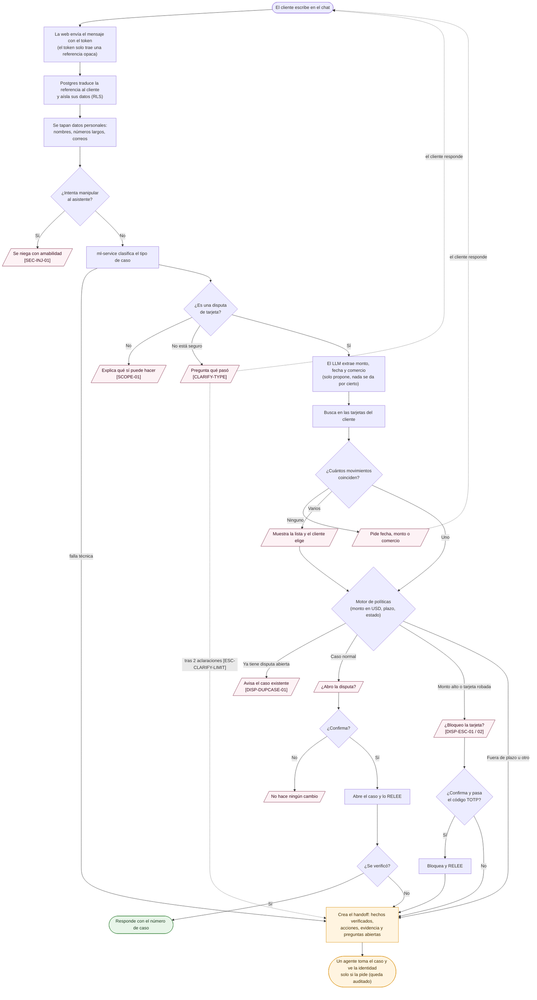

# El viaje de un mensaje

Qué pasa desde que el cliente escribe hasta que recibe respuesta, con cada decisión que toma el sistema.
Los rombos son decisiones; los recuadros inclinados son respuestas al cliente; el código entre corchetes es el
**id de la regla** que queda en la auditoría.



## Paso a paso, en simple

1. **Identificar** — El token del cliente no trae su número de cliente del banco, solo una **referencia opaca**
   (`cr_…`). Postgres la traduce por dentro y desde ahí cada consulta solo ve los datos de ese cliente
   ([[Base de datos y RLS]]). Ver [[Seguridad]] → *Identidad seudonimizada*.
2. **Entender** — Se tapan datos personales antes de que salgan del sistema. Si el texto intenta "hackear" al
   asistente (*"ignora tus instrucciones…"*), se bloquea (`SEC-INJ-01`).
3. **Clasificar** — [[ml-service (clasificador)]] dice qué tipo de disputa es. Si no está seguro, el sistema
   **pregunta** en vez de adivinar. Si se agotan las aclaraciones, pasa a un humano.
4. **Extraer** — El [[LLM]] (DeepSeek) saca monto, fecha y comercio. *Solo propone*: nada se da por cierto
   hasta encontrarlo en la base de datos. Para ganar tiempo, este paso arranca **al mismo tiempo** que el paso 3 y
   se cancela si el mensaje no resulta ser una disputa ([[Orquestador]]).
5. **Buscar** — Las [[Herramientas del banco]] buscan en las tarjetas **de ese cliente**. Una fecha sin año
   ("23/12") es la última vez que pasó. Si hay varias candidatas, el cliente elige; si no hay ninguna, se le dice
   **qué se buscó** y se le pide más detalle.
6. **Decidir** — El [[Motor de políticas]] aplica las reglas y devuelve una decisión con **el id de la regla**.
7. **Actuar** — Nada se ejecuta sin que el cliente **confirme**. Bloquear tarjeta además exige **código TOTP**.
8. **Verificar** — Después de escribir, se **relee** de la base de datos. Si no se puede confirmar, no se dice
   "listo": se escala.
9. **Escalar** — El agente recibe un **resumen estructurado**, nunca el chat crudo. El nombre del cliente está
   cifrado y solo lo ve el agente que **tomó** el caso, cuando lo pide; esa consulta queda en la auditoría.

Cuando se abre una disputa, se bloquea la tarjeta o el caso pasa a un especialista, el cliente además recibe un
**correo** con los mismos datos verificados ([[Notificaciones por correo]]).

Cada paso deja una fila en la **auditoría** y un tramo en la **traza** ([[Observabilidad]]).

> [!example]- Vista técnica: el caso de escalamiento como secuencia
> Ejemplo real del demo: `cliente03` escribe **"No reconozco una compra de 1.450 dólares del lunes"**.
>
> ```mermaid
> sequenceDiagram
>     actor Cli as Cliente
>     participant Web as Web app
>     participant API as Backend
>     participant ML as ml-service
>     participant LLM as LLM (DeepSeek)
>     participant DB as Postgres
>     participant KC as Keycloak
>     Cli->>Web: escribe el mensaje
>     Web->>API: POST /api/chat (token con customer_ref)
>     API->>DB: resolve_customer(ref) y fija el cliente (RLS)
>     API->>ML: ¿qué tipo de disputa es?
>     ML-->>API: unrecognized_charge
>     API->>LLM: extrae monto y fecha (texto enmascarado)
>     LLM-->>API: 1450, lunes 15/06
>     API->>DB: busca transacciones de sus tarjetas
>     DB-->>API: Electro Mundo Online, USA
>     API-->>Web: ¿Confirmas el bloqueo? (requiere código)
>     Web->>API: confirma
>     API-->>Web: 403 step_up_required
>     Web->>KC: acr_values=2
>     KC-->>Web: token con acr=2 (TOTP)
>     Web->>API: confirma otra vez
>     API->>DB: bloquea, relee, crea el handoff y lo relee
>     API-->>Web: Bloqueé tu tarjeta (BLK-…)
> ```
