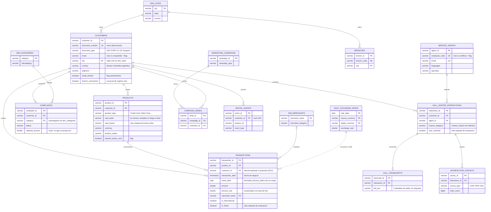
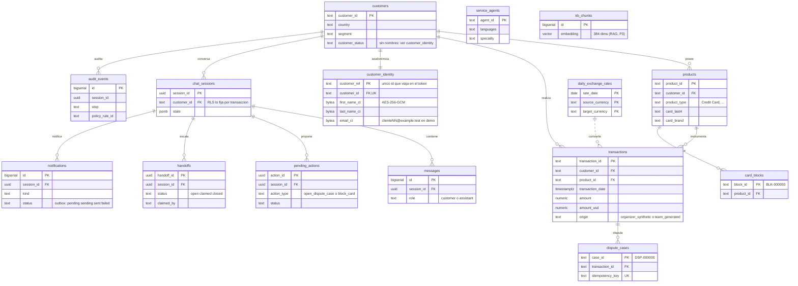

# Modelo ER

> [!tip] Cómo verlo
> Obsidian dibuja estos diagramas solo (Mermaid). Hay dos modelos: la **capa silver** (lo que produce
> `make etl`, en vocabulario canónico del diccionario) y la **base operativa** (contrato C1, lo que usa
> el sistema). Se muestran las columnas clave; el detalle completo por columna está en
> `docs/etl_rules.md` y `infra/postgres/init/01_schema.sql`.

## 1. Capa silver (dataset saneado, `data/silver/`)

Dimensiones y hechos del dataset más las tres dimensiones creadas por la normalización 3FN
(`dim_cities`, `dim_merchants`, `dim_categories`). Las relaciones punteadas del origen que **no se
cumplen** en los datos (sucursal de registro inexistente) no se dibujan: quedaron como banderas.

## 2. Base operativa (contrato C1, Postgres)

Lo que carga `make seed` (`etl/load_postgres.py`) más las tablas que escribe el propio sistema. Todas
las tablas de cliente están bajo RLS; la identidad vive **cifrada** y separada ([[Seguridad]]).

Notas de lectura: `..` = relación lógica (sin FK física); `UK` = único; los flags booleanos de
saneamiento están en [[Datos del proyecto#Validación de duplicados (29 sep)]] y `docs/etl_rules.md`.
