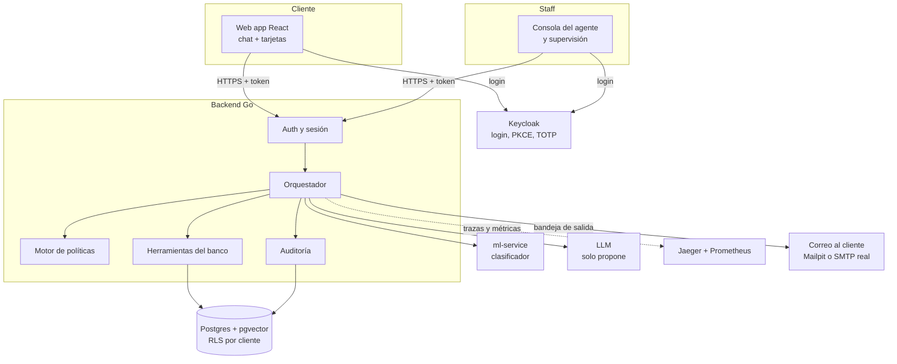

# Visión general

> [!tip] La idea clave
> **La IA propone, el código decide.** El modelo de lenguaje entiende el texto y redacta respuestas. Pero *qué*
> se hace (abrir un caso, bloquear una tarjeta, escalar) lo deciden **reglas escritas en un archivo** y lo
> ejecuta **código Go** que comprueba cada paso.

## Las piezas en una línea

| Pieza | Qué hace | Nota |
|---|---|---|
| Web app | Donde el cliente escribe; muestra tarjetas y movimientos | [[Frontend]] |
| Consola | Donde el agente humano recibe casos escalados | [[Frontend]] |
| Keycloak | Quién eres (login) y qué tan seguro estás (código TOTP) | [[Identidad y login (Keycloak)]] |
| Orquestador | El "cerebro" que sigue Entender → Decidir → Actuar → Verificar → Escalar | [[Orquestador]] |
| Motor de políticas | Lee las reglas del banco y dice qué está permitido | [[Motor de políticas]] |
| Herramientas | Buscar transacciones, abrir caso, bloquear tarjeta, escalar | [[Herramientas del banco]] |
| ml-service | Clasifica el tipo de disputa | [[ml-service (clasificador)]] |
| LLM | Extrae datos del texto y redacta respuestas | [[LLM]] |
| Postgres | Guarda todo; cada cliente solo ve lo suyo (RLS) | [[Base de datos y RLS]] |
| ETL | Trae y limpia los datos del organizador | [[ETL y calidad de datos]] |
| Observabilidad | Trazas de cada conversación y métricas | [[Observabilidad]] |
| Correos | Avisa al cliente cuando se abre una disputa, se bloquea la tarjeta o pasa a un especialista | [[Notificaciones por correo]] |

## Qué es real y qué es provisional

**Ya es real (27 sep):**

| Pieza | Qué hay | Nota |
|---|---|---|
| LLM | **DeepSeek Flash** conectado (Pro de respaldo, simulado como último recurso). Se activa con `LLM_PROVIDER=deepseek` en tu `.env`; el repo trae `fake` por defecto | [[LLM]] |
| Identidad | Referencia opaca en el token, nombres y correo cifrados, identidad visible solo tras tomar el caso | [[Seguridad]] |
| Correos | Bandeja de salida + worker; Mailpit en local, servidor real con redirección a una bandeja de prueba | [[Notificaciones por correo]] |
| Marca | Logo NiceBank en la app, el login y los correos (generado desde una sola imagen) | [[Frontend]] |

**Sigue provisional:**

| Pieza | Hoy | Se reemplaza por | Dueño |
|---|---|---|---|
| Clasificador | Palabras clave | Modelo entrenado (embeddings + regresión logística) | [[Persona 3 - IA y ML]] |
| Prompts del LLM | `deepseek-prompts-v2`, probados con 16 mensajes | Congelarlos tras la evaluación con los casos held-out | [[Persona 3 - IA y ML]] + [[Líder]] |
| Políticas | Borrador v0 | Versión final revisada + FAQ ES/PT | [[Persona 4 - Evaluación y pitch]] |
| Datos de demo | 20 clientes cargados por un script | ETL completo con contratos y linaje | [[Persona 2 - Datos]] |
| Evaluación | Chequeos automáticos de `make smoke` (escenarios 1–9) | ~200 casos held-out con métricas | [[Persona 4 - Evaluación y pitch]] |
| Logos de Visa/Mastercard en correos | Se muestra el nombre de la marca en texto | Archivos PNG con licencia clara (decisión pendiente) | [[Líder]] |

> [!note] ¿Por qué "provisional" no es malo?
> Cada pieza provisional está detrás de una **interfaz** (un contrato). Se cambia por la real sin tocar el
> resto. Ver [[Contratos entre módulos]].

Siguiente: [[El viaje de un mensaje]].
