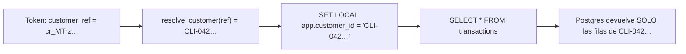

# Base de datos y RLS

> [!tip] En simple
> Usamos **Postgres** con la extensión **pgvector** (para búsquedas por significado, ver [[LLM]]). La regla más
> importante: **Row-Level Security (RLS)**. Es como si la base de datos tuviera un filtro automático: aunque el
> código se equivoque, un cliente **solo puede ver sus propias filas**.

## Cómo funciona el filtro

- El backend se conecta como `app_user`, que **no** es dueño de las tablas y **no** puede saltarse RLS.
- Cada petición abre una transacción y fija `app.customer_id` traduciendo la referencia opaca **del token**
  dentro de Postgres (ver [[Seguridad]] → *Identidad seudonimizada*). El backend nunca escribe `customer_id`:
  las columnas lo toman por defecto de la transacción.
- Los agentes y supervisores usan `app.staff_role` y solo ven `handoffs` y `audit_events`.

## Tablas

| Grupo | Tablas |
|---|---|
| Datos del banco (subset de demo) | `customers` (sin nombres), `products`, `transactions`, `exchange_rates`, `service_agents` |
| Identidad (cifrada) | `customer_identity`: referencia opaca → cliente, nombres cifrados con AES-256-GCM |
| Del sistema | `chat_sessions`, `messages`, `pending_actions`, `dispute_cases`, `card_blocks`, `handoffs`, `audit_events`, `kb_chunks` |

`transactions.origin` distingue datos del organizador (`organizer_synthetic`) de los creados por el equipo
(`team_generated`).

## Detalles prácticos

- Puerto en tu máquina: **5433** (el 5432 lo usa otro PostgreSQL).
- Los scripts de `infra/postgres/init/` solo corren al crear el volumen. Para aplicar cambios de esquema:
  borrar el volumen (`docker compose rm -sfv postgres` + `docker volume rm disputes_pgdata`) y `make seed`.

Archivos: `infra/postgres/init/00_app_role.sh`, `01_schema.sql`, `02_rls.sh`, `backend/internal/store/`.
Relacionado: [[Seguridad]] · [[ETL y calidad de datos]]
