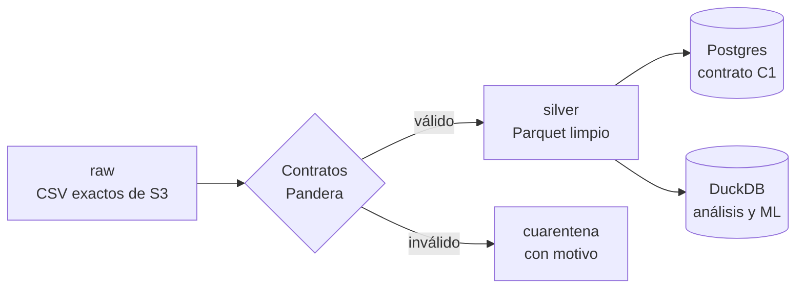

# ETL y calidad de datos

> [!tip] En simple
> **ETL** = *Extract, Transform, Load*: traer los datos, limpiarlos y cargarlos donde el sistema los usa. El
> jurado evalúa que sea **reproducible** (un comando), con **contratos** (reglas de qué es un dato válido),
> **linaje** (de dónde salió cada fila) y una **política de actualización** (qué pasa con los datos que llegan tarde).

## Capas

## Qué existe hoy

| Script | Qué hace |
|---|---|
| `scripts/sync_data.py` (`make data`) | Sincroniza S3 → `data/raw/` (incremental: solo baja lo nuevo) |
| `etl/inventory.py` (`make inventory`) | Genera `docs/data_inventory.md` con archivos, tamaños, filas y alertas |
| `etl/seed_demo.py` (`make seed`) | **Provisional:** carga 20 clientes de demo, sus productos y transacciones, agentes y tasas; crea los usuarios de Keycloak |

## Qué falta (Persona 2)

- [ ] **Perfilado** de las 13 tablas → `docs/data_quality_report.md`
- [ ] **EDA de negocio** → `docs/eda_findings.md` (**Gate 1, lun 28 sep 18:00**)
- [ ] **Pipeline** `etl/pipeline/`: contratos Pandera, deduplicación, cuarentena, linaje (`etl_runs`),
      marca de agua, USD con tasa del día
- [ ] Fixture de **llegada tardía** con tests (`make test-etl`)
- [ ] **Loader** a Postgres que reemplace `seed_demo.py`, idempotente
- [ ] `docs/freshness_policy.md`

## Herramientas

DuckDB (consultas rápidas sobre CSV/Parquet), Polars, Pandera (contratos), PyArrow, psycopg. Todo con
**Poetry**: `poetry add <paquete>` y `poetry run python ...`.

Hallazgos iniciales: [[Datos del proyecto#Hallazgos que hay que explicar]]. Guía: [[Persona 2 - Datos]].
