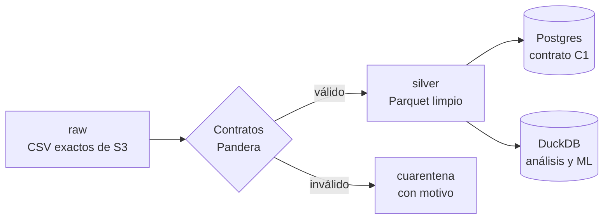

# ETL y calidad de datos

> [!tip] En simple
> **ETL** = *Extract, Transform, Load*: traer los datos, limpiarlos y cargarlos donde el sistema los usa. El
> jurado evalúa que sea **reproducible** (un comando), con **contratos** (reglas de qué es un dato válido),
> **linaje** (de dónde salió cada fila) y una **política de actualización** (qué pasa con los datos que llegan tarde).

## Capas

## Qué existe hoy

| Script | Qué hace |
|---|---|
| `scripts/sync_data.py` (`make data`) | Sincroniza S3 → `data/raw/` (incremental: solo baja lo nuevo) |
| `etl/inventory.py` (`make inventory`) | Genera `docs/data_inventory.md` con archivos, tamaños, filas y alertas |
| `analysis/01_profile.py` (`make profile`) | Perfila la calidad de las 13 tablas → `docs/data_quality_report.md` (~4 min). Lee todo como texto en `data/profile.duckdb` (fuera de Git) y termina con las **reglas para el ETL** |
| `etl/pipeline/` (`make etl`) | **La tubería raw → silver** (~58 min la primera vez; después solo lo nuevo): tipos y dominios del diccionario, estandarización al inglés canónico, `amount_usd` recalculado, deduplicación en 3 niveles, unicidad de correos/teléfonos/códigos, cuarentena con motivo, linaje y marca de agua por archivo. Reglas: `docs/etl_rules.md` |
| `etl/tests/` (`make test-etl`) | 8 pruebas sobre un fixture etiquetado: llegada tardía, idempotencia, cuarentena, duplicado de contenido, unicidad, estandarización |
| `etl/load_postgres.py` (`make seed`) | **El cargador:** todo el dataset silver a Postgres (150k clientes, 400k productos, 4,4M transacciones), en el mismo vocabulario canónico que silver (el backend y el frontend ya lo leen), los mismos 20 clientes de demo en Keycloak, identidad cifrada y las 3 transacciones `team_generated` |
| `etl/seed_demo.py` | Antiguo seed de 20 clientes; queda como biblioteca de utilidades (cifrado, realm) y respaldo |

## Qué falta (Persona 2)

- [x] **Perfilado** de las 13 tablas → `docs/data_quality_report.md` (28 sep)
- [x] **EDA de negocio** → `docs/eda_findings.md` (Gate 1, 28 sep)
- [x] **Pipeline** `etl/pipeline/` con contratos, dedup, cuarentena, linaje, marca de agua y USD (29 sep)
- [x] Fixture de **llegada tardía** con tests (`make test-etl`, 29 sep)
- [x] **Loader** a Postgres (`etl/load_postgres.py`, 29 sep) — falta verificar `make smoke` con la carga completa
- [x] `docs/freshness_policy.md` (29 sep)
- [ ] Números y gráficos para el pitch (`analysis/03_business_case.py`)

## Herramientas

DuckDB (consultas rápidas sobre CSV/Parquet), Polars, Pandera (contratos), PyArrow, psycopg. Todo con
**Poetry**: `poetry add <paquete>` y `poetry run python ...`.

Hallazgos: [[Datos del proyecto#Hallazgos que hay que explicar]] y [[Datos del proyecto#Lo que encontró el perfilado]].
Guía: [[Persona 2 - Datos]].

> [!important] Reglas que el perfilado le deja al pipeline
> La fecha de negocio sale del **timestamp del evento** (hay un corte de día a las 06:00/08:00); deduplicar por
> llave aunque hoy no haya duplicados; carga incremental con prueba de llegada tardía; **recalcular `amount_usd`**;
> normalizar "Mexico"/"México" sin perder las compras internacionales; no exigir `registration_branch_id` como
> llave foránea; límites de vacíos por columna, no un 5% global; `affected_product_id` fuera de los cruces;
> coordenadas en (0, 0) → vacías. Detalle en la sección "What this means for the ETL" del informe.
