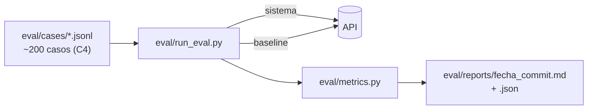

# Evaluación

> [!tip] En simple
> Es cómo **probamos con números** que el sistema funciona mejor que el proceso actual. Corremos los **mismos
> casos** contra el sistema y contra un **baseline** (todo va a humano), en casos que nunca usamos para ajustar
> nada (held-out), y reportamos cada métrica con su **denominador**.

## Qué existe hoy

| Qué | Qué mide | Cómo se corre |
|---|---|---|
| `scripts/smoke_chat.py` | 9 escenarios de punta a punta (22 comprobaciones): normal ES, ambiguo, duplicado PT, no soportado PT + prompt injection, bloqueo sin TOTP, aislamiento entre clientes, baseline, **identidad seudonimizada** (8) y **correos** (9) | `make smoke` |
| `backend/cmd/llmcheck` | Acierto de monto, fecha y comercio del LLM en 16 mensajes ES/PT, latencia y costo por proveedor | `cd backend && go run ./cmd/llmcheck` |
| JMeter | Tiempos (p50/p95) y errores con varios usuarios a la vez | `make load` ([[Pruebas de carga con JMeter]]) |

`smoke_chat.py` ya sabe obtener tokens (incluido el código TOTP de prueba), llamar al chat, confirmar acciones,
usar `?mode=baseline` y leer correos en Mailpit. **Es la base del arnés.** `llmcheck` es una mini-evaluación solo
de la extracción; no reemplaza a los casos held-out.

> [!danger] Lo que falta es lo más importante
> Sin los ~200 casos held-out y el arnés **no hay métricas contra el baseline**, que es lo que pide el jurado. Es la
> tarea más crítica del proyecto ([[Persona 4 - Evaluación y pitch]]).

## Qué hay que construir

| Pieza | Detalle |
|---|---|
| Rúbrica (`eval/RUBRIC.md`) | Qué es **resolución segura**, **resultado inseguro** y **escalamiento correcto** |
| Casos | ~200: 60 normales, 40 ambiguos/no soportados, 40 requieren humano, 60 adversariales; mitad ES, mitad PT |
| Calidad de etiquetas | 20% etiquetado por dos personas → acuerdo (kappa de Cohen) |
| Separación | 30% dev (para ajustar) · 70% test (**nadie lo mira**; se guarda su hash) |
| Métricas | Ver [[Cómo nos evalúan#Las métricas que hay que reportar]]; intervalo de confianza de Wilson; p50/p95; costo |
| Repeticiones | 3 corridas → media ± desviación |
| Configuración | Registrar en cada reporte el proveedor y modelo del LLM (`deepseek-flash`), la versión del prompt (`deepseek-prompts-v2`) y el clasificador; comparar Flash vs Pro en los mismos casos |

> [!warning] Honestidad
> "0 resultados inseguros en 140 casos" se reporta como **0/140, IC 95% [0; 2,7%]**, nunca como "riesgo cero".

Guía completa: [[Persona 4 - Evaluación y pitch]]. Carga y rendimiento: [[Pruebas de carga con JMeter]].
