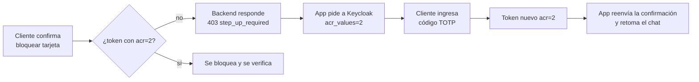

# Identidad y login (Keycloak)

> [!tip] En simple
> **Keycloak** es el "portero": comprueba quién eres y te entrega un **token** (una credencial digital firmada)
> que dice tu referencia opaca de cliente (`customer_ref`), tu rol y qué tan fuerte fue tu verificación. El backend confía **solo** en ese token.

## Lo que hay configurado (realm `latam-bank`)

| Pieza | Qué hace |
|---|---|
| Cliente `web` | La app. Login con **Authorization Code + PKCE** (el estándar seguro para apps web) |
| Cliente `eval-harness` | Solo para pruebas automáticas y JMeter (*direct grant*). **Se elimina en producción** |
| Roles | `customer`, `agent`, `supervisor` |
| Niveles (LoA) | Nivel 1 = contraseña · Nivel 2 = contraseña + **código TOTP** (vale 5 min) |
| Tema `nicebank` | Login, código, cierre de sesión y recuperación con la identidad del banco (logo NiceBank), en ES/PT/EN |
| Claim `customer_ref` | Referencia opaca del cliente (`cr_` + 24 caracteres); el token **no** trae el número de cliente del banco. Ver [[Seguridad]] |
| Recuperación | Usuario → enlace por correo (10 min, un solo uso) → **verificar TOTP** → nueva contraseña |
| Política de contraseña | 8+ caracteres, mayúscula, minúscula, número, distinta al usuario |
| Correo | En desarrollo llega a **Mailpit** (http://localhost:8025). Con servidor real usa **la misma cuenta y servidor** que las notificaciones y el mismo diseño oscuro |

## El correo de recuperación

- El realm (`latam-bank-realm.json`) no guarda ninguna clave: tiene marcadores `${KC_SMTP_HOST}`,
  `${KC_SMTP_USER}`, `${KC_SMTP_PASSWORD}`… que `docker-compose.yml` llena desde las mismas variables del `.env`
  que usa el backend (`SMTP_HOST`, `EMAIL_USERNAME`, `EMAIL_PASSWORD`, `MAIL_FROM`). Si hay `EMAIL_PASSWORD`, se
  activan SSL y login.
- `cliente20` es el usuario de demo de recuperación: su correo es tu `MAIL_REDIRECT_TO` (si no hay, una dirección
  `@example.test` que cae en Mailpit).
- La plantilla del correo está en `infra/keycloak/themes/nicebank/email/` (ES, PT y EN).

> [!warning] Cambiaste el `.env` y el correo sigue saliendo por Mailpit
> Keycloak lee esas variables **solo al importar el realm**. Hay que recrearlo:
> `docker compose up -d --force-recreate keycloak` (también restablece las contraseñas de prueba).

Pendiente: probar el correo de recuperación **de punta a punta con el servidor real**.

## Step-up (el código extra para acciones sensibles)

> [!danger] Por qué el flujo de recuperación es propio
> El flujo por defecto de Keycloak **borra el TOTP** al recuperar la contraseña. Quien entre a tu correo podría
> cambiar la contraseña **y** registrar su propio celular. Nuestro flujo `reset-credentials-verified` exige el
> código del celular original.

## Usuarios de prueba

`cliente01–20` (con TOTP), `agente01–02`, `supervisor01`, `carga01–20` (solo para JMeter, sin TOTP). Detalle en
[[Credenciales y accesos]].

Archivos: `infra/keycloak/latam-bank-realm.json`, `infra/keycloak/themes/nicebank/`, `backend/internal/auth/`,
`frontend/src/auth/`.
