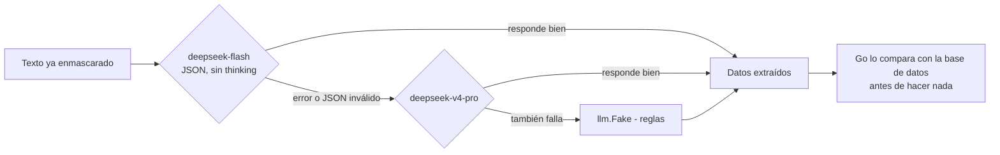

# LLM (modelo de lenguaje)

> [!tip] En simple
> Un **LLM** es un modelo de IA ya entrenado (como Claude o DeepSeek) al que llamamos por API. Aquí tiene un papel
> **acotado**: sacar datos del texto y redactar respuestas. **Nunca decide** acciones, permisos ni reglas.

| Usa LLM | No usa LLM (código determinista) |
|---|---|
| Extraer fecha, monto y comercio de *"me cobraron 3 veces en Oxxo ayer"* | Login, sesión, código TOTP |
| Entender "la segunda" al elegir una transacción (solo si las reglas locales no alcanzan) | Permisos y RLS |
| Redactar la respuesta **solo** con hechos verificados (opcional) | Qué acción se toma (políticas) |
| | Ejecutar y verificar herramientas |

## La interfaz (`backend/internal/llm/llm.go`)

```go
type Provider interface {
    Extract(ctx, maskedText, lang, today) (Extraction, Usage, error)
    PickCandidate(ctx, maskedText, merchants) (int, Usage, error)
    Compose(ctx, ComposeInput) (string, Usage, error)
}
```

Hay dos implementaciones, y se elige con `LLM_PROVIDER` en `.env`:

| `LLM_PROVIDER` | Archivo | Para qué |
|---|---|---|
| `fake` (por defecto en el repo) | `fake.go` | Reglas + plantillas ES/PT. Gratis, rápido y **determinista**: pruebas, CI, JMeter sin costo |
| `deepseek` (lo que usa el líder en su `.env`) | `deepseek.go` | DeepSeek real (ADR 0004) |

## Cómo usa DeepSeek



- **Modelos**: `deepseek-flash` (V4.1 Flash, el **principal**; el nombre viejo `deepseek-v4-flash` también sirve) y
  `deepseek-v4-pro` (respaldo). Se cambian con `LLM_MODEL` y `LLM_FALLBACK_MODEL`.
- **Elegir candidata** ("la segunda", "la del cine"): primero reglas locales (gratis e instantáneo); solo si no
  alcanza, pregunta al modelo.
- **Redactar** (`LLM_COMPOSE`): `template` (por defecto) usa las plantillas revisadas. `ai` deja que el modelo las
  reescriba, pero **solo se usa si conserva todos los datos verificados** (monto, caso, tarjeta); si no, plantilla.
- **Fechas**: si el modelo devuelve una fecha futura o de hace más de 13 meses, se descarta. Una fecha **sin año**
  ("23/12") es la **última vez que ocurrió** esa fecha (23/12/2025), nunca una fecha futura.
- **Costo**: cada turno reporta tokens y USD (precio pico, conservador). Métrica `llm_calls_total` en Prometheus.
- **Si DeepSeek se cae**, el turno sigue funcionando con las reglas: nunca se bloquea al cliente.

> [!warning] La clave
> `DEEPSEEK_API_KEY` va **solo** en tu `.env` local (ignorado por git). Nunca en el código, en el chat del equipo
> ni en commits. Si una clave se compartió por un canal abierto, se **rota** en el panel de DeepSeek. Si la línea
> del `.env` tiene algo más después de la clave (una nota, un espacio), DeepSeek responde **401**: ver
> [[Problemas comunes]].

## Por qué elegimos Flash (la comparación)

Herramienta: `cd backend && go run ./cmd/llmcheck` — manda **16 mensajes etiquetados** (ES y PT) a cada proveedor
y cuenta cuántos datos acierta. Con `DEEPSEEK_API_KEY` definida llama a DeepSeek (una corrida cuesta menos de un
centavo de dólar); sin clave, solo prueba el simulado.

| Proveedor | Monto | Fecha | Comercio | Tiempo típico (p50) | Costo de las 16 llamadas |
|---|---|---|---|---|---|
| Simulado (`fake`) | 81% | 87% | 0% | 0 ms | 0 |
| **DeepSeek Flash** | **100%** | **93%** | **100%** | **1,0 s** | **USD 0,0017** |
| DeepSeek Pro | 100% | 93% | 100% | 1,55 s | USD 0,0045 |

**Flash acierta lo mismo que Pro, es más rápido y cuesta menos de la mitad** → Flash principal, Pro de respaldo.
El único fallo de ambos es el borde de "semana passada" (termina el día 9 o el 10). El simulado no entiende montos
en palabras ("mil quinientos"), fechas tipo "3 de enero" ni nombres de comercio.

> [!info] ¿Qué es p50?
> Es el **tiempo típico**: la mitad de las respuestas tardó menos que eso. El **p95** es el tiempo de las más
> lentas: el 95% tardó menos. Ver [[08 Glosario|Glosario]].

## Cómo lo hicimos más rápido

1. **Prompt v2 con caché** (`deepseek-prompts-v2`): el mensaje de instrucciones ("system prompt") es **idéntico en
   cada llamada**; la fecha de hoy pasó al mensaje del usuario. Así DeepSeek reutiliza automáticamente lo que ya
   leyó antes (*caché de prompt*): mismo acierto que v1 y p50 de **~0,87 s**.
2. **Extracción en paralelo**: el orquestador pide los datos al LLM **al mismo tiempo** que el clasificador decide
   si el mensaje es una disputa. Si resulta que no lo es (por ejemplo "quero um empréstimo"), la llamada se
   **cancela** en pocos milisegundos. Detalle en [[Orquestador]].

## Reglas para el proveedor real

- Recibe **solo texto enmascarado** (sin nombres, documentos, correos ni números de tarjeta).
- Devuelve **JSON** validado; si falla, se usa el camino seguro (preguntar o escalar).
- Reporta `Usage` (tokens y costo) → alimenta la métrica de costo por caso.
- Los prompts están versionados en `backend/internal/llm/deepseek.go` (`PromptVersion`). Nunca editar uno ya
  evaluado sin subir la versión (`v2` → `v3`) y volver a correr `llmcheck`.

## RAG (búsqueda de políticas)

Para responder preguntas como *"¿cuánto tarda una disputa?"*, se buscan los fragmentos de política y FAQ más
parecidos en la tabla `kb_chunks` (pgvector) y el LLM responde **solo** con ellos. Tarea pendiente de
[[Persona 3 - IA y ML]].

Proveedor decidido: **DeepSeek Flash** (ADR 0004, ver [[Decisiones (ADR)]]). Queda repetir la comparación Flash vs
Pro sobre los casos held-out de la [[Evaluación]] antes de congelar la configuración final.
