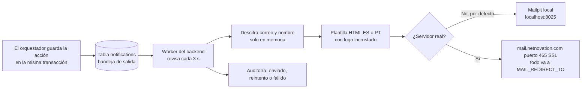

# Notificaciones por correo

> [!tip] En simple
> Cuando el asistente **abre una disputa**, **bloquea una tarjeta** o **pasa el caso a un especialista**, el
> cliente recibe un correo de `NiceBank <nicebank@evon.solutions>` con los datos verificados, **en el idioma de la
> conversación** (español o portugués). El diseño se inspira en los correos de viáticos del equipo, pero con la
> paleta de NiceBank.

## Cómo funciona



- **Bandeja de salida (outbox)**: el correo se guarda en la **misma transacción** que la acción. Si la acción no
  se guardó, no hay correo; si se guardó, el correo sale aunque el servidor de correo esté caído un rato.
- **En paralelo**: el worker toma hasta 10 correos por vuelta y manda **hasta 3 a la vez** (cada uno con su
  conexión), sin saturar el servidor.
- **Reintentos**: hasta 4 intentos (30 s, 2 min, 4,5 min…). Si un envío se queda a medias, a los 5 min se retoma.
- **Privacidad**: la dirección del cliente está **cifrada** como los nombres ([[Seguridad]] → *Identidad
  seudonimizada*). La auditoría registra "correo enviado", nunca la dirección. El saludo usa solo el primer nombre.
- **Qué correos hay**: *disputa abierta* · *tarjeta bloqueada* · *caso con especialista* (este último no se manda
  si ya salió el de tarjeta bloqueada). Las corridas en modo *baseline* no envían nada.
- **Métrica**: `notifications_total{kind,status}` ([[Observabilidad]]).

## Cómo se ve

| Elemento | Detalle |
|---|---|
| Fondo | Tarjeta oscura, como los correos de viáticos |
| Colores | **Solo la paleta NiceBank**: burgundy `#7A1F3D` en la línea superior y el botón; rosa del logo `#E5769A` en títulos y datos destacados |
| Logo | El logo NiceBank va **incrustado** en el correo (imagen adjunta *inline*, "CID"): se ve sin descargar nada de internet |
| Datos | Tabla con número de disputa, motivo, comercio, monto, fecha y tarjeta |
| Tarjeta | Muestra la marca: *"Visa terminada en 2457"* (ES) o *"Visa final 2457"* (PT) |
| Seguridad | Nota fija: NiceBank nunca pide contraseñas ni códigos por correo |
| Botón | "Ver mi caso en NiceBank" → `MAIL_APP_URL` (hoy `localhost`; en el despliegue, la URL pública) |

> [!note] Logos de Visa y Mastercard (pendiente)
> El correo ya sabe mostrar el logo de la marca si existe el archivo PNG en `backend/internal/notify/assets/`
> (`visa.png`, `mastercard.png`, `amex.png`). Hoy no hay archivos y se muestra el **nombre** en texto. Falta decidir
> la fuente (theSVG o Flaticon/kit oficial de Mastercard) y anotar su licencia en el `README.md` de esa carpeta.

> [!danger] Nunca a clientes del dataset
> El dataset trae correos que **parecen reales** (gmail, protonmail…). Con el servidor real, el backend **no
> arranca** si no hay `MAIL_REDIRECT_TO`: todos los correos van a esa bandeja de prueba. Solo en un despliegue real
> se podría usar `MAIL_ALLOW_REAL_RECIPIENTS=true`, y hay que pedirlo explícitamente.

## Cómo activar el servidor real

En tu `.env` (nunca en el repo):

```bash
SMTP_HOST=mail.netnovation.com
SMTP_PORT=465
SMTP_SECURITY=ssl
EMAIL_USERNAME=<la cuenta>
EMAIL_PASSWORD=<la clave>
MAIL_FROM=nicebank@evon.solutions
MAIL_REDIRECT_TO=<tu correo de prueba>
```

Luego `docker compose up -d backend`. La cuenta debe tener permiso para enviar **como** `nicebank@evon.solutions`
(alias). Ver [[Decisiones (ADR)]] → 0005.

## Correo de recuperación de contraseña (Keycloak)

Sale por **el mismo servidor y la misma cuenta** que las notificaciones, con **el mismo diseño oscuro**. El realm
tiene marcadores `${KC_SMTP_*}` que Keycloak llena al importar con las mismas variables del `.env` (la clave nunca
queda en el repo). Si hay `EMAIL_PASSWORD`, se activan SSL y login automáticamente. El usuario de demo `cliente20`
recibe en tu `MAIL_REDIRECT_TO`; los demás usuarios de prueba tienen direcciones `@example.test`.

> [!warning] Después de cambiar variables de correo
> Keycloak solo lee el `.env` cuando **importa** el realm: `docker compose up -d --force-recreate keycloak`
> (esto también restablece las contraseñas de prueba). Ver [[Identidad y login (Keycloak)]].

Pendiente: una **prueba real** del correo de recuperación con el servidor de Netnovation (en local con Mailpit ya
funciona).

## Cómo se prueba

`make smoke` (escenario 9) abre una disputa y un caso con especialista y comprueba en Mailpit que llegaron los dos
correos desde el alias correcto. Las pruebas de Go (`notify_test.go`) revisan la plantilla (escapa HTML, idioma,
marca de la tarjeta) y el envío SMTP (redirección, texto + HTML, imágenes incrustadas).

Archivos: `backend/internal/notify/` (`worker.go`, `mailer.go`, `templates.go`, `templates/layout.html`,
`assets/`), `backend/internal/orchestrator/notifications.go`, `infra/keycloak/themes/nicebank/email/`.
