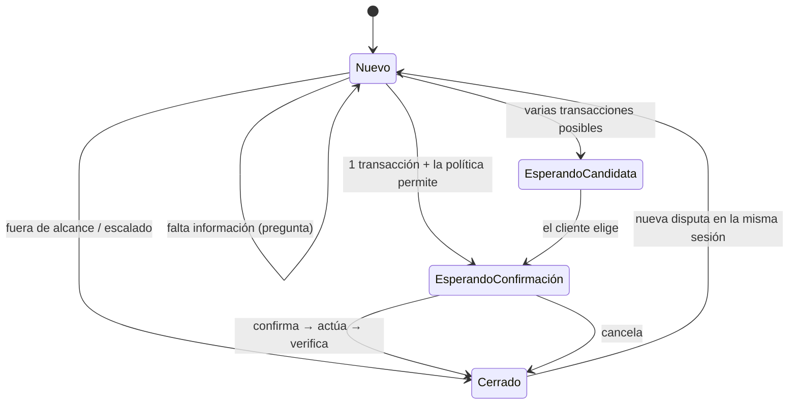
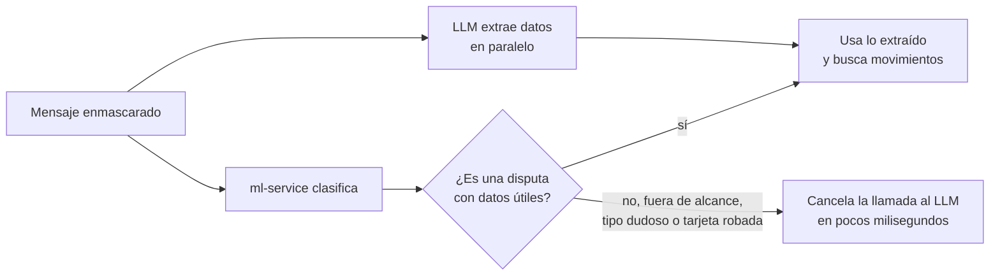

# Orquestador

> [!tip] En simple
> Es el **director de orquesta** de cada conversación. No "piensa" como la IA: sigue una **máquina de estados**
> (una lista fija de pasos y transiciones). Así su comportamiento es predecible, testeable y auditable.

## Los estados de una conversación

## Reglas que aplica en cada turno

| Situación | Qué hace | Regla |
|---|---|---|
| Texto intenta cambiar instrucciones o pedir reembolsos | Se abstiene y recuerda el alcance | `SEC-INJ-01` |
| Pide un préstamo, inversión, etc. | Se abstiene y redirige | `SCOPE-01` |
| El clasificador no está seguro | Pregunta qué pasó | `CLARIFY-TYPE` |
| No encuentra la transacción | Dice **qué buscó** y pide fecha, monto o comercio | `CLARIFY-NOTFOUND` |
| Varias candidatas | Muestra tarjetas para elegir | `CLARIFY-MULTI` |
| Más de 2 aclaraciones sin éxito | Escala a humano | `ESC-CLARIFY-LIMIT` |
| La transacción ya tiene caso abierto | Informa el número de caso | `DISP-DUPCASE-01` |
| Falla ml-service o una tasa | Escala por falla técnica | `ESC-TECH-01` |
| Tarjeta robada / fraude de monto alto | Propone bloqueo (con TOTP) y escala | `DISP-ESC-02` / `DISP-ESC-01` |

Cada decisión guarda su **id de regla** en la auditoría: eso es la "explicación" del sistema (no el
razonamiento de la IA, que no sirve como evidencia).

## Clasificar y extraer al mismo tiempo

Antes, cada turno hacía dos pasos seguidos: primero el clasificador ("¿es una disputa?") y después el LLM ("¿qué
monto, fecha y comercio?"). Ahora el orquestador **lanza los dos a la vez** (en Go, con una *goroutine*: una
tarea que corre en paralelo). El turno tarda lo que tarde el más lento, no la suma de los dos.

- Si el mensaje no es una disputa, la llamada al LLM se **cancela** y no se espera; si ya había terminado, su costo
  igual se cuenta.
- La tarea en paralelo **no toca la base de datos** ni el estado de la conversación: solo devuelve su resultado.
- Métricas: `llm_speculative_extractions_total{outcome="used"|"discarded"}` y
  `llm_calls_total{status="cancelled"}` ([[Observabilidad]]).
- Archivo: `speculative.go` (con su test `speculative_test.go`).

## Cómo busca el movimiento

| Lo que dijo el cliente | Dónde busca |
|---|---|
| Una fecha o un rango | Solo esas fechas |
| Una fecha **sin año** ("23/12") | La **última vez** que pasó esa fecha (23/12/2025, no un 23/12 futuro) |
| Monto o comercio, pero **sin fecha** | Todo el historial cargado (hasta 400 días) |
| Nada concreto | Los últimos 30 días |

Si no encuentra nada, la respuesta **dice qué buscó**, por ejemplo: *"No encontré ningún movimiento de 999,99 del
3 de enero en tus tarjetas. ¿Me confirmas la fecha y el monto…?"*. Las fechas muestran el año cuando no es el
año actual.

## Correos y auditoría

Cuando una acción se confirma (disputa abierta, tarjeta bloqueada, caso con especialista), el orquestador deja el
correo en la **bandeja de salida** dentro de la misma transacción de base de datos: si la acción no se guardó, no
hay correo. En modo baseline no se manda nada. Ver [[Notificaciones por correo]].

## Modo baseline

`POST /api/chat?mode=baseline` simula el proceso actual: palabras clave y **todo caso de disputa va a un
humano**. Sirve para comparar en la [[Evaluación]].

## Archivos

`backend/internal/orchestrator/orchestrator.go` (flujo), `speculative.go` (extracción en paralelo),
`notifications.go` (bandeja de salida de correos), `identity.go` (nombres descifrados en memoria y revelar
identidad al agente), `handoff.go` (resumen para el agente), `baseline.go`, `queries.go` (consola y supervisión).

Relacionado: [[El viaje de un mensaje]] · [[Motor de políticas]] · [[Herramientas del banco]]
