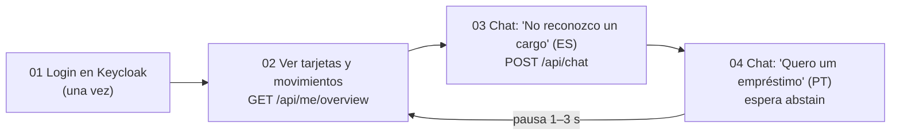

# Pruebas de carga con JMeter

> [!tip] En simple
> **Apache JMeter** simula a muchos clientes usando el sistema al mismo tiempo y mide cuánto tarda cada paso y
> cuántos fallan. Nos dice **hasta dónde aguanta** el sistema y **dónde se pone lento**.

## Qué simula el plan (`qa/jmeter/nicebank-load.jmx`)

Cada "usuario virtual" hace, en bucle:



> [!info] Usuarios de carga
> Usa `carga01`–`carga20` (archivo `qa/jmeter/users.csv`): mismos clientes de demo pero **sin código TOTP**. Por eso
> una prueba de carga **nunca** puede bloquear tarjetas. Existen solo en el entorno local.

## Cómo correrlo

1. Instalar JMeter 5.6+ (requiere Java 8 o superior) y agregarlo al `PATH`. En el PC del líder está en
   `C:\Users\uriel\Documents\apache-jmeter-5.6.3` (el ejecutable es `bin\jmeter.bat`).
2. Levantar el sistema: `docker compose up -d` y `make seed`.
3. Desde la raíz del repo:
   ```bash
   make load            # perfil de humo: 5 usuarios, 60 s
   ```
   Sin `make` o sin JMeter en el `PATH` (Windows, PowerShell):
   ```powershell
   & "C:\Users\uriel\Documents\apache-jmeter-5.6.3\bin\jmeter.bat" -n -t qa/jmeter/nicebank-load.jmx -Jusers=5 -Jramp=10 -Jduration=60 -f -l qa/jmeter/results/results.jtl -e -o qa/jmeter/results/report
   ```
   O un perfil a medida (por ejemplo, carga):
   ```bash
   jmeter -n -t qa/jmeter/nicebank-load.jmx -Jusers=25 -Jramp=60 -Jduration=600 -f -l qa/jmeter/results/results.jtl -e -o qa/jmeter/results/report
   ```
4. Abrir `qa/jmeter/results/report/index.html` (panel con percentiles, throughput y errores).

Para editarlo con interfaz gráfica: `jmeter` → *File → Open* → `qa/jmeter/nicebank-load.jmx`.

> [!info] Lo que se corrigió en el plan (27 sep)
> - El archivo de usuarios `users.csv` se busca **junto al `.jmx`**, así funciona desde cualquier carpeta.
> - El login en Keycloak manda el tipo de contenido de **formulario** (`application/x-www-form-urlencoded`); antes
>   heredaba el de JSON y Keycloak rechazaba el pedido.

## Última corrida (27 sep, perfil de humo)

5 usuarios, 60 s, LLM = **DeepSeek Flash**. **0 errores.**

| Paso | Veces | Errores | p50 (típico) | p95 (más lentas) |
|---|---:|---:|---:|---:|
| Login en Keycloak | 5 | 0 | 115 ms | 116 ms |
| Ver tarjetas y movimientos | 38 | 0 | 5 ms | 9 ms |
| Chat: cargo no reconocido (ES) | 38 | 0 | 970 ms | 1.299 ms |
| Chat: fuera de alcance (PT) | 34 | 0 | 12 ms | 138 ms |

- Con el LLM **simulado** (`fake`) el chat responde en **~15–65 ms**: la diferencia es la llamada al modelo.
- El mensaje fuera de alcance es rápido aunque haya LLM real porque la extracción en paralelo **se cancela** en
  cuanto el clasificador dice que no es una disputa ([[Orquestador]]).
- **p50** = tiempo típico (la mitad tardó menos); **p95** = tiempo de las más lentas (el 95% tardó menos).

## Perfiles

| Perfil | Usuarios | Subida | Duración | Para qué |
|---|---:|---:|---:|---|
| Humo | 5 | 10 s | 60 s | Que el plan funcione de punta a punta |
| Carga | 25 | 60 s | 10 min | Concurrencia esperada el día del demo |
| Estrés | 100 | 2 min | 10 min | Encontrar el punto de quiebre |
| Resistencia | 20 | 60 s | 1 h | Fugas de memoria, degradación en el tiempo |

## Qué mirar (KPIs)

| KPI | Objetivo inicial | Cómo leerlo |
|---|---|---|
| Tasa de error | < 1% | Columna *Error %* del reporte |
| p95 del chat (`03 POST chat`) | < 800 ms con el simulado; con DeepSeek la referencia es ~1,3 s | *95th pct* |
| p95 de cuentas (`02 GET overview`) | < 300 ms | Consulta simple a Postgres con RLS |
| Throughput | reportar turnos/s por perfil | *Throughput* |

Mientras corre, mirar **Prometheus** (`chat_turn_duration_seconds`, `chat_turns_total`) y abrir un par de
**trazas en Jaeger** para ver en qué paso se va el tiempo. Ver [[Observabilidad]].

> [!warning] Honestidad en el reporte
> Son **mediciones locales en una laptop**, no de producción. Reportar hardware, perfil, duración y versión del
> sistema. Con el LLM real, la latencia y el costo cambian: medir los dos escenarios por separado.

## Ideas para ampliar el plan

- Escenario de **consola del agente** (`agente01`: listar y abrir handoffs).
- Flujo con **confirmación** (abre casos: usar datos que se puedan resetear con `make seed`).
- Pruebas de **picos** (*spike*): de 5 a 100 usuarios en 10 s.
